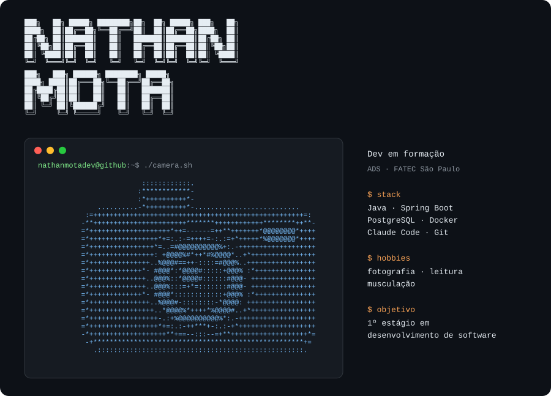

  

# 👋 Olá, eu sou Nathan Mota

🎓 Estudante de **Análise e Desenvolvimento de Sistemas** na FATEC São Paulo
💻 Em busca de oportunidades de **estágio em Desenvolvimento de Software**
🚀 Aprendendo, construindo projetos e evoluindo todos os dias.

---

## 🧑‍💻 Sobre mim

Sou estudante de Análise e Desenvolvimento de Sistemas, apaixonado por **tecnologia, corrida e desenvolvimento de software**.

Atualmente estou focado em fortalecer minha base em **programação, orientação a objetos, bancos de dados e desenvolvimento de aplicações**.

Gosto de transformar problemas do dia a dia em projetos que possam ser resolvidos através da tecnologia.

🎯 Meu objetivo é iniciar minha carreira como desenvolvedor e continuar evoluindo tanto tecnicamente quanto profissionalmente.

---

## 🛠️ Tecnologias e ferramentas

### 💻 Linguagens

### 🗄️ Banco de Dados

### 🔧 Ferramentas

---

## 🚀 Projeto em destaque

### 🏠 República

API REST + interface web para dividir as contas de uma casa compartilhada: quem pagou, quem participa, quem deve quanto a quem e quando cobrar.

O projeto nasceu de uma necessidade real: em repúblicas e apartamentos compartilhados, as contas se perdem em planilhas e grupos de WhatsApp. A República registra cada gasto, divide automaticamente entre quem participou, compensa dívidas cruzadas e mostra o que cada um precisa pagar ou receber.

**O que já faz:**

* 💸 Divisão de despesas em centavos (`BigDecimal`), sem perder nenhum centavo
* 🔁 Compensação automática de dívidas nos dois sentidos ("quem deve quanto a quem")
* 📨 Cobrança com prazo opcional e controle de status (`PENDENTE → COBRADA → PAGA`)
* 📅 Contas fixas que se repetem todo mês
* 🔐 Login com JWT, convite por código e visão individual por morador

**Tecnologias utilizadas:**

* ☕ Java 17 e Spring Boot 3 (Web, Data JPA, Validation, Security)
* 🗄️ H2 no desenvolvimento e PostgreSQL em produção
* 📄 Swagger (springdoc-openapi) e testes com JUnit 5 + MockMvc
* 🌐 Front-end em HTML, CSS e JavaScript
* 🐳 Docker
* 🤖 Claude Code (desenvolvimento assistido por IA)
* 🎨 Claude Design (protótipos e design da interface)
* 🐙 Git & GitHub

📌 Em fase final de preparação para o **deploy** (Render + PostgreSQL).

🔗 [Ver repositório](https://github.com/nathanmotadev/AdministradorDespesasRepublica)

---

## 📚 Atualmente estudando

* ☕ Java, Spring Boot e Programação Orientada a Objetos
* 🗄️ SQL e modelagem de bancos de dados
* 🌐 Desenvolvimento Web
* 🔌 APIs REST e autenticação com JWT
* 🚢 Deploy e Docker
* 🐙 Git e GitHub
* 🏗️ Engenharia de Software
* 🤖 Desenvolvimento assistido por IA com Claude Code

---
## 🎯 Objetivos

* 🚀 Conseguir minha primeira oportunidade de estágio em desenvolvimento
* 💻 Construir projetos cada vez mais completos
* 🗄️ Aprofundar meus conhecimentos em bancos de dados
* 🌐 Aprender desenvolvimento backend e APIs
* 📚 Evoluir constantemente como desenvolvedor

---

## 📫 Entre em contato

💼 [LinkedIn](https://www.linkedin.com/in/nathan-mota-ba596438a/)

🐙 [GitHub](https://github.com/nathanmotadev)

---

⭐ Obrigado por visitar meu perfil!
